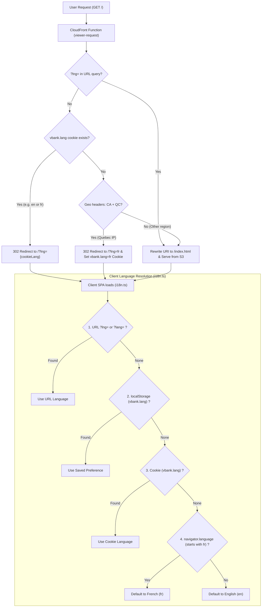

# Localization & Language Selection

This document describes how language localization is detected, routed, and persisted across the edge layer (AWS CloudFront) and the client layer (Single-Page Application with `i18next`).

---

## Language Selection Flow

Language selection is evaluated in two phases: **Edge Routing** (CloudFront Function) and **Client Initialization** (`i18n.ts`).

---

## Priority Order

When the client application boots, it determines the active language according to the following strict hierarchy:

| Priority | Source | Description |
| :---: | :--- | :--- |
| **1** | **URL Parameter (`?lng=` or `?lang=`)** | Explicit URL override (e.g. set by CloudFront redirect or link sharing). Takes highest precedence. |
| **2** | **`localStorage` (`vbank.lang`)** | The user's explicit preference chosen in the in-app Settings screen. |
| **3** | **Cookie (`vbank.lang`)** | Set by CloudFront edge function on the first visit or synchronized from a previous session. |
| **4** | **Browser Language (`navigator.language`)** | System/browser language. If it starts with `fr` (e.g. `fr-CA`, `fr-FR`), French is selected. |
| **5** | **Default Fallback** | `en` (English). |

---

## Edge Layer: CloudFront & Geolocation

* **Origin Request Policy (`aws_cloudfront_origin_request_policy.spa` in [`iac/main.tf`](../iac/main.tf))**:
  * Passes `CloudFront-Viewer-Country`, `CloudFront-Viewer-Country-Region`, and the `vbank.lang` cookie to the CloudFront Function.
  * Leaves the **Cache Policy** as `Managed-CachingOptimized` (URL path only), which prevents S3 static asset cache fragmentation across different geographic regions.
* **Viewer Request Function ([`iac/spa-rewrite.js`](../iac/spa-rewrite.js))**:
  * Evaluates incoming requests to `/` and `/index.html`.
  * If a visitor originates from Quebec (`CA-QC`) and has no prior cookie, CloudFront issues an HTTP 302 redirect to `/?lng=fr` and writes `Set-Cookie: vbank.lang=fr`.
  * If the user previously chose English or French, their cookie is respected, redirecting to their preferred language even if browsing from Quebec.
  * Preserves any existing query parameters (e.g. `/?ref=promo` $\rightarrow$ `/?ref=promo&lng=fr`).
  * Rewrites extension-less SPA routes (e.g. `/requests`, `/settings`) to `/index.html`.

---

## User Language Switching

When a user toggles the language switcher in the **Settings** screen:
1. `setLang(lng)` is called in [`src/frontend/src/i18n.ts`](../src/frontend/src/i18n.ts).
2. The choice is saved to `localStorage.setItem('vbank.lang', lng)`.
3. The choice is written to `document.cookie` (`vbank.lang=${lng}; max-age=31536000; path=/; samesite=lax`).
4. The browser URL query string is updated without reloading via `window.history.replaceState`.
5. `i18n.changeLanguage(lng)` triggers an immediate UI re-render and sets `document.documentElement.lang`.

---

## Automated Tests

* **CloudFront Edge Tests ([`src/frontend/src/test/spa-rewrite.test.ts`](../src/frontend/src/test/spa-rewrite.test.ts))**:
  * Unit tests validating Quebec detection, cookie preference overrides, query string preservation, non-Quebec passthrough, and asset routing.
* **Frontend Localization Tests ([`src/frontend/src/i18n.test.ts`](../src/frontend/src/i18n.test.ts))**:
  * Tests checking the full priority cascade (`URL` $\rightarrow$ `localStorage` $\rightarrow$ `cookie` $\rightarrow$ `navigator` $\rightarrow$ fallback) and `setLang` synchronization.
